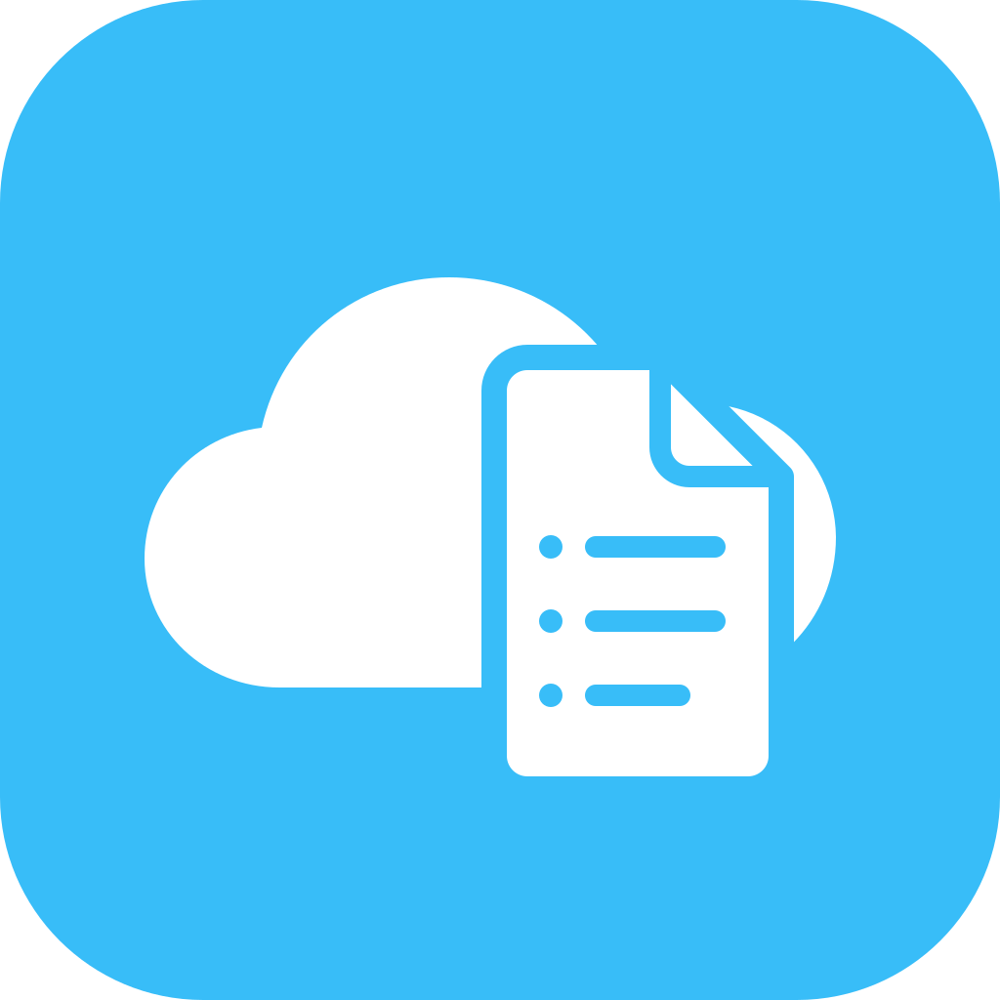

# Singularity Menus

**A clear picture for the whole team.** Self-hosted display boards for production floors, handovers, notices, schedules, performance figures, cafés and reception areas.

One local server hosts the editor and display pages. Open a permanent screen address on any TV, tablet, computer or kiosk browser on your network. Publish a change and connected displays update within about five seconds. No Raspberry Pi, cloud account, subscription or external asset service is needed.

## Start with Docker

Install Docker Engine and Docker Compose v2 (or Docker Desktop). **Your server does not need the source code or build tools.** Copy just `compose.yaml` into a directory on your server, optionally with a `.env` file.

The production configuration pulls the prebuilt image:

```text
ghcr.io/endlesszombiez/singularity-menus:latest
```

**First publication:** the image becomes available after the repository's **Validate and publish Docker image** workflow succeeds on the default branch. Adding these files locally does not publish an image. See [Publishing images](#publishing-images) below.

This repository is currently private, so the image is private by default. Sign in on your server using `docker login ghcr.io --username YOUR_GITHUB_USERNAME` and enter a GitHub personal access token (classic) with `read:packages` at the password prompt. The account must have access to the package. Docker stores the login locally; do not put the token in Compose or `.env`. If the package owner explicitly makes the package public later, login is unnecessary.

Then run:

```sh
docker compose pull
docker compose up -d --wait
```

Open **http://YOUR_SERVER_IP:8080** from a browser on your LAN. On first run, choose your workspace name, timezone and admin password. There is no default password. Complete setup before other people start using the server.

Three published sample boards and a `production-floor` screen are included. Edit or remove the samples as you make the workspace your own.

On a TV or kiosk browser, open:

```text
http://YOUR_SERVER_IP:8080/display/production-floor
```

Set the browser to fullscreen or kiosk mode. The display also offers a fullscreen button when the pointer moves over it. Browser launch-on-boot and keeping the TV awake are configured on the display device itself.

Reserve your server's IP in your router so bookmarks keep working. Allow inbound TCP port 8080 on your server's firewall for your local subnet. TVs and the server must be able to reach each other; isolated guest Wi-Fi commonly blocks this.

### Configuration

Copy `.env.example` to `.env` to change the host port or initial timezone:

```dotenv
PORT=8080
SINGULARITY_IMAGE=ghcr.io/endlesszombiez/singularity-menus:latest
TZ=America/New_York
COOKIE_SECURE=false
```

`SINGULARITY_IMAGE` selects the image. For controlled updates, replace `latest` with a published version such as `1.0.0`, or pin an exact `@sha256:...` digest from GHCR. Only select tags that have actually been published. Images support Linux AMD64 and ARM64, including ordinary servers and compatible NAS hosts.

`PORT` changes the host port; the container listens on 8080. Choose the workspace timezone during setup or in Settings; changing `TZ` does not overwrite an existing workspace. Set `COOKIE_SECURE=true` only when an HTTPS reverse proxy serves the app. Administration over plain HTTP is intended for a trusted LAN. Do not forward the service directly onto the public internet.

### Storage and lifecycle

SQLite content, the hashed admin password and the session signing key live in the `singularity-data` named volume at `/data`. The container runs as an unprivileged user, drops Linux capabilities and has a read-only root filesystem. Runtime data is writable only in its volume and temporary directory.

```sh
docker compose logs --tail=100
docker compose ps
docker compose down
```

`down` preserves data. **`docker compose down -v` deletes the data volume.**

To update: download a backup from Settings, select the desired image tag if you pin versions, then run:

```sh
docker compose pull
docker compose up -d --wait
```

Keep the Compose directory/project name the same so Docker reuses the existing data volume. To roll back the application, select an earlier published image tag and repeat those commands. Data migrations in future releases may require restoring a matching backup; check their release notes.

For full disaster recovery, stop the container and back up the named volume as well; that preserves the admin account and session key. JSON content backups exclude credentials.

### Publishing images

The GitHub Actions workflow runs Python tests, JavaScript tests and a production-configured container smoke test **before** publishing to GHCR. Publishing uses GitHub's built-in `GITHUB_TOKEN`; no stored registry secret is needed. The job requests `packages: write`, which must be permitted by repository/organization Actions policy.

- Pushes to the default branch (`main` or `master`) publish `latest` and a full `sha-<commit>` tag.
- Pushing a version tag such as `v1.0.0` publishes `1.0.0`, `1.0`, and a `sha-<commit>` tag. Version tags do not replace `latest`.
- Pull requests validate without publishing. Non-default `main`/`master` branches validate without publishing.
- You can rerun the workflow manually on the default branch through Actions.

Check the successful workflow and the repository's linked GHCR package before pulling an image for the first time. Packages remain private unless their owner changes visibility. `manifest unknown` usually means that tag has not been published; `denied` or `unauthorized` usually means the server needs a login or package access.

### Optional: build from source

Developers can still use the separate override:

```sh
docker compose -f compose.yaml -f compose.build.yaml up -d --build --wait
```

The override builds `singularity-menus:local`. Production uses only `compose.yaml` and never requires a build.

## Use the workspace

1. **Templates:** choose one of eight templates and one of its three themes.
2. **Boards:** edit names, titles, entries, themes and footers. Add, remove and reorder entries while watching the preview.
3. **Save draft:** keep working without changing live displays.
4. **Publish board:** make the draft available to screens. Publishing does not automatically assign it to a screen.
5. **Screens:** create a readable, permanent address and assign a published default board. Open the address on your display. Multiple physical devices can use the same address.
6. **Schedule:** add weekday/time windows to show a different published board. Otherwise the default board appears. Overlaps are rejected; overnight windows belong to their start day.
7. **Settings:** change the workspace name/timezone, update the password, or export and restore content.

Screen status means its address was requested in the last 20 seconds. It confirms browser contact, not that the physical panel is powered on. Multiple devices sharing an address appear as one logical screen.

### Production task list

Each task has a title, owner, work-order/notes field, due time, priority (Normal, High, Urgent) and status (To do, In progress, Done, Blocked). The board summarizes total tasks, work in progress, completed tasks and blockers. Tasks remain in the order you choose.

Set the plan date when preparing each day or shift. Dates and completed tasks do not reset automatically. Duplicate a board to prepare another shift without disturbing the published one. This V1 displays plans for workers arriving at work; it does not record clock-ins.

### Templates and themes

| Template | Three themes |
| --- | --- |
| Production task list | Night shift · Daylight · Blueprint |
| Shift briefing | Command · Paper · Signal |
| Noticeboard | Bulletin · Editorial · Electric |
| Daily agenda | After hours · Studio · Timetable |
| Performance dashboard | Control room · Clarity · Terminal |
| Café & menu | Midnight café · Daily special · Terracotta |
| Safety & checklist | Safety first · Clear guidance · Hazard |
| Welcome & wayfinding | Concierge · Gallery · Landmark |

Boards use a 16:9 landscape layout and scale to fit the screen. Long boards cycle through pages; set 5–120 seconds per page in the editor. Use concise titles and notes for viewing at a distance; long fields can be truncated in the display layout. Portrait screens are letterboxed.

V1 supports up to 100 boards, 100 logical screen addresses, 100 entries per board and 100 scheduled windows. Performance figures are entered manually. There is one admin account, without publication history or external data integrations.

## Offline behavior

All scripts, fonts and styles are local. Internet access is unnecessary after installation. If a running player loses its connection, it keeps showing the last received board with a connection notice and retries automatically. The browser cache is best-effort and depends on the kiosk's storage settings.

A cold browser launch still needs the local server to load the application. Offline players cannot fetch newly scheduled boards. Keep the server clock synchronized; schedules follow the workspace timezone, including daylight saving time. Repeated DST minutes repeat their windows; skipped minutes are skipped.

## Backups and password recovery

Settings → **Download backup** exports boards (drafts and published versions), screens, schedules and workspace settings. Restore validates the whole file before replacing content. Credentials stay unchanged. Download your current backup before restoring. Keep backups private because they may contain internal work plans.

If you forget the admin password and have Docker access:

```sh
docker compose exec singularity python manage.py reset-password
```

The command securely prompts for a new password and invalidates existing admin sessions. It does not erase content.

## Run without Docker

Python 3.11+ is required (the Docker image uses Python 3.13):

```sh
python -m venv .venv
```

Activate on Windows PowerShell:

```powershell
.venv\Scripts\Activate.ps1
```

Or Linux/macOS:

```sh
. .venv/bin/activate
```

Then:

```sh
python -m pip install -r requirements.txt
python server.py
```

The production Waitress server listens on `0.0.0.0:8080`. Data defaults to `./data`. Override `DATA_DIR` and `PORT` through environment variables if needed. Recovery outside Docker is `python manage.py reset-password` with the same `DATA_DIR` as the server.

## Validation

```sh
python -m pip install -r requirements-dev.txt
python -m pytest -q
```

JavaScript renderer tests need Node.js 20+ (Node is not needed to run the app):

```sh
node --test tests/*.test.mjs
```

Tests cover access control and CSRF, all 24 template/theme combinations, draft/publish isolation, conflicting revisions, screen assignments, weekly/overnight schedule boundaries, DST offsets, overlap detection, input validation, backup restoration, restart persistence, and renderer escaping/pagination.

Health check: `GET /health` returns `{"status":"ok","version":"1.0.0"}` after checking database access. Validate Compose with `docker compose config`.

## Reference and architecture

Inspired by [Max's Menu](https://github.com/mogrinz/maxs-menu)'s central editor, permanent screen URLs and automatic updates. This is an independent implementation, without its Pi services or restaurant-only model. See [the reference analysis and V1 architecture](docs/REFERENCE-ANALYSIS.md) for the comparison, data flow and boundaries.

MIT licensed. Built with Flask, Waitress, SQLite and browser-native JavaScript/CSS.
